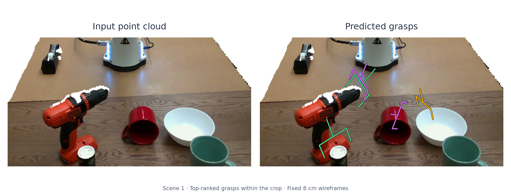

# Contact-GraspNet Baseline

Pretrained Contact-GraspNet inference and grasp visualization using the
[PyTorch port](https://github.com/elchun/contact_graspnet_pytorch).

This baseline supports the proposed Point Transformer V3 (PTv3) extension in
[Contact-GraspTransformer](https://github.com/dineshvarunshankar/Contact-GraspTransformer), which contains the full final implementation.

This repository provides a Docker environment, a contact-to-pose conversion
utility, and an Open3D visualizer. It includes saved predictions for 14 example
scenes. The model, checkpoints, and input scenes come from the pinned submodule.



## Setup

Requires Git, Docker, and an NVIDIA GPU with NVIDIA Container Toolkit for the default build.

```bash
git clone --branch dinesh_varun/baseline --recurse-submodules https://github.com/dineshvarunshankar/Contact-GraspNet.git
cd Contact-GraspNet
make build
```

[Additional setup options](docs/setup.md) cover CPU builds, Blackwell GPUs, and host visualization.

## Run

Run inference on the example scenes:

```bash
make inference
```

Predictions are saved in `results/`. The upstream inference script opens a viewer for each scene.

Show the saved predictions for scene 9:

```bash
make visualize
```

The visualizer shows the top 50 grasps per segment and saves a PNG.
Docker visualization requires a Linux desktop with X11 access.

## Code

- `p1/pose_utils.py`: contact points, directions, and widths to SE(3) grasp poses.
- `p1/visualization.py`: point clouds and gripper wireframes in Open3D.
- `p1/visualize_predictions.py`: visualization of saved prediction files.
- `contact_graspnet_pytorch/`: upstream model, pretrained weights, and example scenes.

## References

- [Contact-GraspNet paper](https://arxiv.org/abs/2103.14127), Sundermeyer et al., ICRA 2021.
- [Original TensorFlow implementation](https://github.com/NVlabs/contact_graspnet).
- [PyTorch implementation](https://github.com/elchun/contact_graspnet_pytorch).
- [Contact-GraspTransformer extension](https://github.com/dineshvarunshankar/Contact-GraspTransformer).
